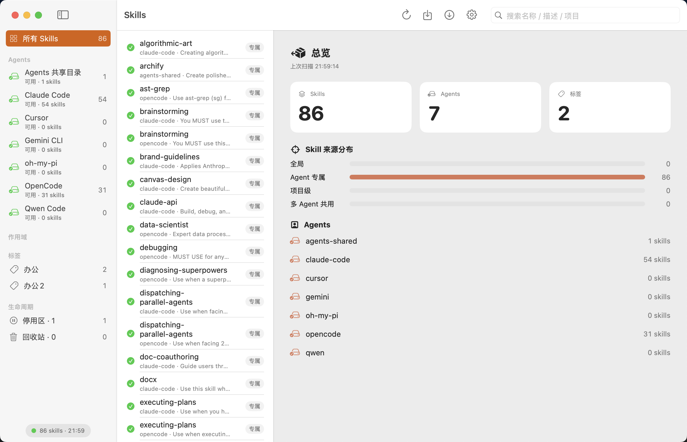
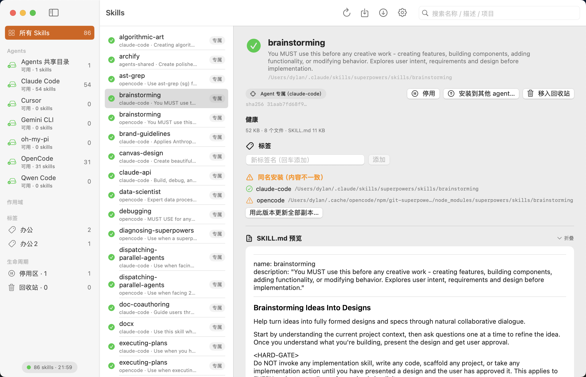
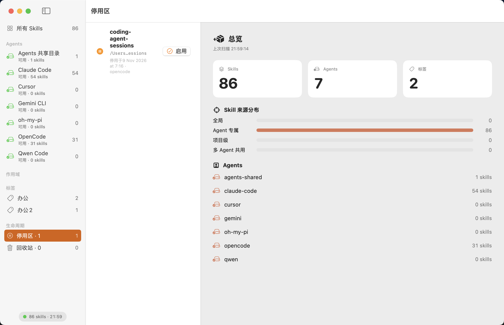
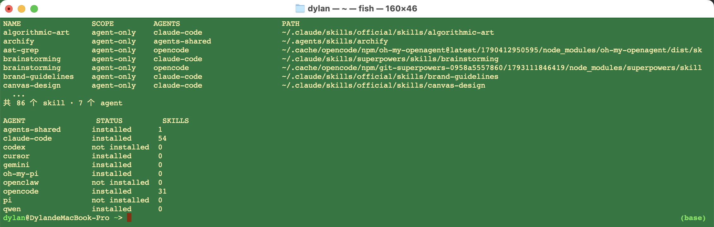

# AgentKeeper

[](https://github.com/yangl326-Dylan/agentkeeper/actions/workflows/ci.yml)
[](LICENSE)


[](https://github.com/yangl326-Dylan/agentkeeper/releases/latest)

[中文](#中文) | [English](#english)

---

<a id="中文"></a>

**跨 agent 的 skill 管理工具。** 你的 skill 装在哪、谁在用、版本一不一致——一屏说清，一个按钮摆平。

> 核心管理功能永久免费。开源协议 MIT。



## 为什么需要它

用多个 AI agent（Claude Code / OpenCode / Codex / Cursor / Gemini CLI…）的人，skill 散落在 7+ 个目录里，还有 npm 插件缓存这种深水区：

- 装了什么 skill？哪些 agent 能用？——没人说得清
- 同一个 skill 拷到多个 agent 后，改了一处，其他处悄悄过时
- 想停用一个 skill 又怕搞坏 agent 配置

AgentKeeper 解决这三件事：**统一目录 → 分歧检测 → 安全停用/回滚**。

## 功能

- 🔍 **全机扫描**：11 个内置 agent 覆盖主流工具的标准目录、共享目录与插件缓存（含 OpenCode v2 npm 缓存、DeepSeek Harness）
- 🧩 **自定义 agent**：写 `~/.agentkeeper/agents.json` 即可接入长尾 agent，无需重新编译或等发版（[接入指南](docs/adding-an-agent.md)）
- 🔄 **应用内更新**：设置页手动检查 GitHub Release，发现新版本可直接下载并原地更新（外部无红点/角标）
- 🧭 **三维度筛选**：按 agent（谁能用）× 作用域（在哪生效：全局/Agent 专属/项目级/多 Agent 共用）× 标签（做什么用），任意叠加成交集
- ⚠️ **同名安装检测**：跨 agent 副本内容指纹对比，一键「用当前版本更新全部副本」（覆盖前自动快照）
- 🛡️ **安全停用**：原子搬移到统一停用目录 + manifest 记录原路径 + 快照 + 操作历史，随时恢复
- 🩺 **健康检查**：frontmatter 完整性、空文件 / 编码异常 / 坏链接等结构问题逐项列出，体积事实一目了然（只报客观事实，不做主观阈值判定）
- 👁️ **生效关系**：同名 skill 因优先级被遮蔽时明确提示「哪个真正生效」（Claude Code / DeepSeek Harness 项目级 > 用户级，官方规则硬编码）；多 agent 共同加载与用户级目录串扰一并说明
- 📑 **扁平 skill 支持**：DeepSeek Harness 的单文件 `<name>.md` 形态照常扫描展示（详情只读）
- 📦 **Git 安装**：直接从 git 仓库安装 skill 集
- 📄 **SKILL.md 预览**：块级 markdown 渲染（标题/代码块/列表/引用），可折叠、可滚动
- 📁 **Finder 式文件清单**：双击/右键在 Finder 中定位
- 🌗 **日夜间主题**：系统语义色，默认跟随系统
- 🧑‍💻 **CLI 伴随**：`ak` 命令——GUI 管人，CLI 管 agent（agent 也可以自己调用）

### 界面速览

| 同名分歧检测（指纹对比 + 一键拉平） | 安全停用（停用区 · 随时启用） |
| :---: | :---: |
|  |  |

## 安装

**(1) 一键安装 Release 产物（推荐，universal 双架构）**：直接下载 [v0.1.0 Release](https://github.com/yangl326-Dylan/agentkeeper/releases/latest) 或复制命令块——

```bash
curl -L -o /tmp/ak.zip https://github.com/yangl326-Dylan/agentkeeper/releases/latest/download/AgentKeeper-cli-macos.zip
unzip -o /tmp/ak.zip -d /tmp/ak-install && sudo install -m 0755 /tmp/ak-install/ak /usr/local/bin/ak
ak doctor
```

**Skill 安装（让 AI agent 自动用上 `ak`）**：

```bash
npx skills add yangl326-Dylan/agentkeeper --skill agentkeeper   # skills.sh 生态，75+ agent
```

Claude Code 也可走插件市场：`/plugin marketplace add yangl326-Dylan/agentkeeper` → `/plugin install agentkeeper@agentkeeper`。

**(2) 从源码构建**（需要 Swift 6.0+ / macOS 15+）：

```bash
git clone https://github.com/yangl326-Dylan/agentkeeper.git
cd agentkeeper
scripts/build-app.sh release   # 构建 AgentKeeper.app
swift build -c release         # 构建 ak CLI
.build/release/ak doctor       # 检查本机 agent 安装状态
```

📄 完整安装文档（含 App 安装、未公证构建的处理）：[INSTALL.md](INSTALL.md)
🤖 给 AI agent 的安装与使用说明：[AGENTS.md](AGENTS.md)

## CLI 速览



`ak list` / `ak doctor` 只读，随时可安全执行；完整命令见 [AGENTS.md](AGENTS.md)。

## 开发

```bash
swift test        # 392 个测试（TDD 全覆盖）
swift build       # 全部 target（GUI + ak CLI）
```

技术栈：Swift 6 / SwiftUI / Swift Testing；模块化 Package（DomainKit / InfraKit / AppCore / AgentKeeperUI / ak）。

## Roadmap

- [ ] 同名副本 diff 查看器
- [ ] Git 真源持续同步（drift 可视化 + 一键拉平；合并来源可见性安全叙事）
- [ ] ⌘K 全局搜索 + Quick Look
- [ ] 启动包（一键安装精选 skill 集）
- [x] 生效关系 v1（同名遮蔽判定：claude-code 项目级 > 用户级；串扰说明；依赖断裂预警见下一版）
- [x] Skill 健康检查 v1（frontmatter 完整性 / 结构异常 / 体积事实；阈值判定与跨 agent 字段兼容见 v1.5）
- [x] Adapter 声明式协议（单源 `AgentSpec`；内置 agent 加一个字面量，长尾 agent 写 `agents.json`）
- [ ] Homebrew cask + 公证构建

详见 [docs/superpowers/specs/2026-11-01-oss-strategy-design.md](docs/superpowers/specs/2026-11-01-oss-strategy-design.md)。

## Contributing

Issue / PR 欢迎——尤其是给新 agent 加 adapter（内置 = 一个 `AgentSpec` 字面量；详见 [docs/adding-an-agent.md](docs/adding-an-agent.md)）。

使用问题、想法和下一步优先级，请走 [Discussions](https://github.com/yangl326-Dylan/agentkeeper/discussions)——比开 Issue 更合适。

## License

[MIT](LICENSE)

---

<a id="english"></a>

# AgentKeeper

**Skill management across AI agents.** Where your skills live, who can use them, whether copies drifted apart — one screen to see it, one click to fix it.

> Core features are free forever. MIT licensed.


## Why

If you run multiple AI agents (Claude Code / OpenCode / Codex / Cursor / Gemini CLI…), your skills are scattered across 7+ directories — including npm plugin caches:

- Nobody can answer "what skills do I have, and which agents see them?"
- Copy a skill to several agents, edit one copy, the others silently drift
- Disabling a skill feels risky — you might break your agent setup

AgentKeeper fixes exactly this: **unified catalog → drift detection → safe disable/rollback**.

## Features

- 🔍 **Full-machine scan**: 10 built-in agents covering mainstream tools' standard paths, shared dirs and plugin caches (including OpenCode v2 npm cache)
- 🧩 **Custom agents**: drop a `~/.agentkeeper/agents.json` to bring in long-tail agents — no recompile, no release wait ([guide](docs/adding-an-agent.md))
- 🔄 **In-app updates**: check GitHub releases from Settings and update in place — no badges or red dots anywhere else
- 🧭 **Three filter dimensions**: agent × scope (global / agent-only / project / multi-agent) × tags — stack them freely
- ⚠️ **Same-name copy detection**: content fingerprints across agents; update every copy from the current version (auto-snapshot first)
- 🛡️ **Safe disable**: atomic move + manifest + snapshots + operation history
- 📦 **Git install**: pull skill sets straight from git repos
- 📄 **SKILL.md preview**: block-level markdown renderer, collapsible and scrollable
- 📁 **Finder-style file list**: reveal in Finder via double-click or context menu
- 🌗 **Light/dark theme**: system semantic colors, follows system by default
- 🧑‍💻 **CLI companion**: `ak` — the GUI is for humans, the CLI is for agents (agents can invoke it too)

### Screenshots

| Same-name drift detection (fingerprint diff + one-click sync) | Safe disable (disabled shelf · re-enable anytime) |
| :---: | :---: |
|  |  |

## Install

**(1) One-shot release install (recommended, universal binary)** — grab the [latest release](https://github.com/yangl326-Dylan/agentkeeper/releases/latest) or paste:

```bash
curl -L -o /tmp/ak.zip https://github.com/yangl326-Dylan/agentkeeper/releases/latest/download/AgentKeeper-cli-macos.zip
unzip -o /tmp/ak.zip -d /tmp/ak-install && sudo install -m 0755 /tmp/ak-install/ak /usr/local/bin/ak
ak doctor
```

**Skill install (let AI agents pick up `ak` automatically)**:

```bash
npx skills add yangl326-Dylan/agentkeeper --skill agentkeeper   # skills.sh ecosystem, 75+ agents
```

Claude Code users can also use the plugin marketplace: `/plugin marketplace add yangl326-Dylan/agentkeeper` → `/plugin install agentkeeper@agentkeeper`.

**(2) Build from source** — Swift 6.0+ / macOS 15+. (Homebrew cask coming soon.)

```bash
git clone https://github.com/yangl326-Dylan/agentkeeper.git
cd agentkeeper
scripts/build-app.sh release   # GUI app
swift build -c release         # ak CLI
.build/release/ak doctor
```

📄 Full install guide (App setup, Gatekeeper workaround): [INSTALL.md](INSTALL.md)
🤖 Instructions for AI agents installing/using `ak`: [AGENTS.md](AGENTS.md)

## CLI at a glance


`ak list` / `ak doctor` are read-only and always safe to run; full usage in [AGENTS.md](AGENTS.md).

## Development

```bash
swift test   # 392 tests, full TDD coverage
```

## Contributing

Issues and PRs welcome — especially new agent adapters (built-in = one `AgentSpec` literal; see [docs/adding-an-agent.md](docs/adding-an-agent.md)).

For usage questions, ideas and roadmap priorities, please use [Discussions](https://github.com/yangl326-Dylan/agentkeeper/discussions).

## License

[MIT](LICENSE)
